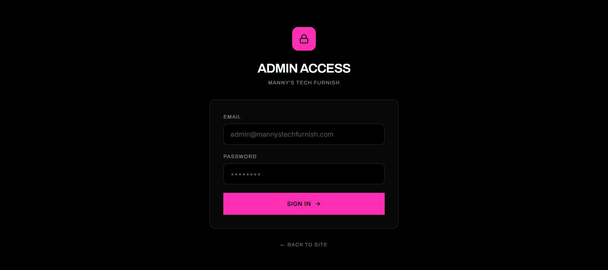
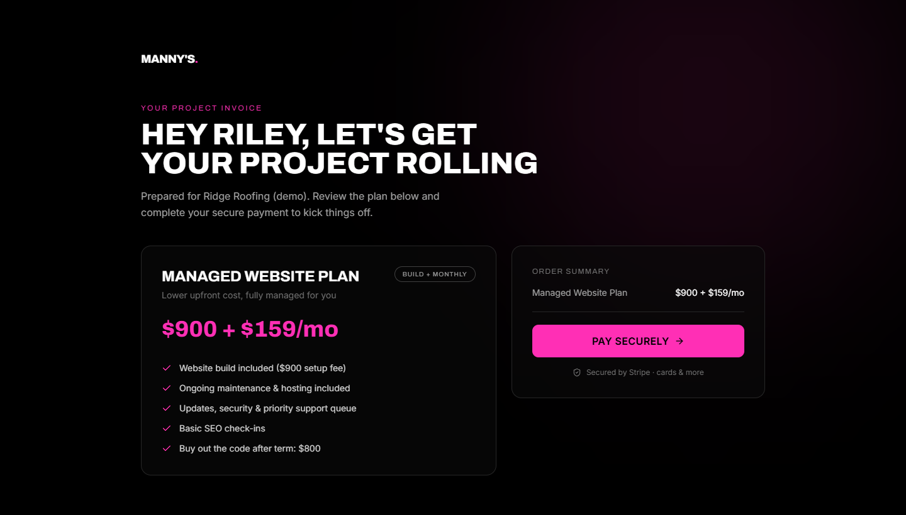
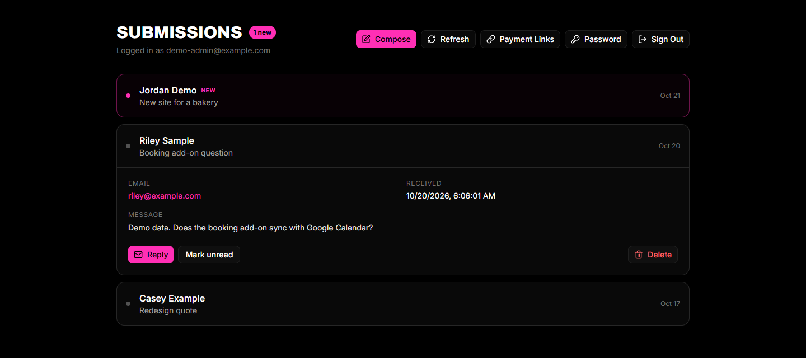
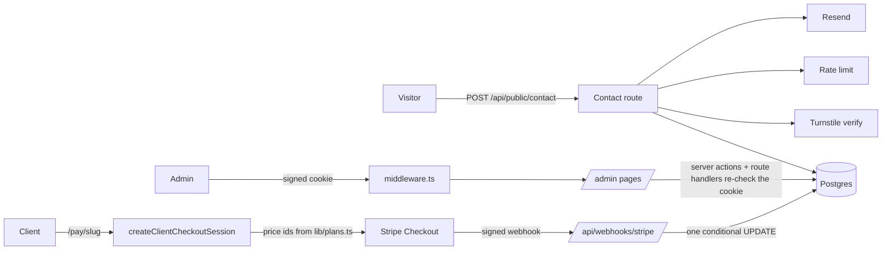

# Manny's Tech Furnish

The production site and back office for my web development studio: **[mannystechfurnish.com](https://mannystechfurnish.com)**.

It does three jobs. It markets the studio, it captures leads through a bot-protected contact form, and it gets clients paid through per-client Stripe checkout links that I create from a private admin dashboard.

[](https://github.com/spoutyfc/mannystechfurnish/actions/workflows/ci.yml)



| Client invoice page (`/pay/[slug]`) | Admin inbox with an inquiry expanded |
|---|---|
|  |  |

<sub>The admin and invoice screenshots use seeded demo records (example.com addresses), not real clients. They were taken from a production build running against a throwaway local Postgres.</sub>

<details>
<summary>Marketing home page (desktop and 390px mobile)</summary>


<p align="center"></p>
</details>

## What's worth looking at

| If you have 2 minutes | Read |
|---|---|
| How a payment can never be downgraded, even under concurrent webhooks | [`lib/payment-status.ts`](lib/payment-status.ts), [`app/api/webhooks/stripe/route.ts`](app/api/webhooks/stripe/route.ts) |
| Why the browser can never choose the price | [`lib/checkout.ts`](lib/checkout.ts), [`app/actions/payment.ts`](app/actions/payment.ts) |
| A signed session cookie that works in Edge middleware and Node | [`lib/admin-auth.ts`](lib/admin-auth.ts), [`middleware.ts`](middleware.ts) |
| A rate limiter that degrades instead of failing open | [`lib/rate-limit.ts`](lib/rate-limit.ts), [`lib/request.ts`](lib/request.ts) |

## Stack

| Layer | Choice |
|---|---|
| Framework | Next.js 16 (App Router, server actions, route handlers), React 19, TypeScript |
| Data | Postgres (Neon in production) with Drizzle ORM over `pg` (`lib/db/schema.ts`) |
| Auth | HMAC-signed admin session cookie (`lib/admin-auth.ts`) and bcrypt password hashes |
| Payments | Stripe Checkout Sessions for client invoices, and Stripe Payment Links for the public pricing table |
| Email | Resend, with escaped HTML templates (`lib/email.ts`) |
| Abuse controls | Cloudflare Turnstile, sliding-window rate limits (Upstash Redis, with an in-process fallback), and a honeypot field |
| UI | Tailwind CSS v4, Framer Motion, Lenis, OGL (WebGL hero) |
| Quality | Vitest, ESLint 9 (next/core-web-vitals and typescript, zero warnings allowed), `tsc --noEmit`, GitHub Actions on Ubuntu |
| Runtime | Vercel in production. A multi-stage Docker image (Next standalone output, non-root) is also included |

## What it does

**Public site**
- `/` is the marketing page: work, services, pricing (Stripe Payment Links), paid add-ons and an FAQ.
- `/contact` is an inquiry form. The server validates the input, checks Turnstile and the rate limit, stores it in Postgres and emails both me and the sender.
- `/pay/[slug]` is a personal invoice page for one client. The price always comes from the plan stored on the server.
- `/demo/booking` is a working front-end demo of the booking add-on.

**Admin** (`/admin`, gated in middleware and again on every handler)
- An inbox of contact submissions, each marked new, read or resolved, or deleted.
- A composer that sends branded emails to a client through Resend.
- `/admin/clients` creates a client on a plan, copies their pay link, marks a payment and shows totals collected.
- Password change, which re-verifies the current password.

## Architecture



### Payment flow

1. In the admin dashboard I create a client and pick a plan (`option1` or `option2`). The server generates an unguessable slug.
2. The client opens `/pay/<slug>`. That page reads only the public fields it needs: name, company, plan and whether it is paid.
3. **Pay** calls a server action. It validates the slug, refuses if the invoice is already paid, and builds the Stripe line items from stored price ids (`lib/checkout.ts`). The browser never sends an amount.
4. Stripe calls `/api/webhooks/stripe`. The route verifies the signature, then applies the event:
   - `checkout.session.completed` marks the client paid only when `payment_status` is `paid` (or `no_payment_required`). Delayed methods such as ACH arrive as `unpaid`, stay pending, and are settled by `checkout.session.async_payment_succeeded` or `async_payment_failed`.
   - The "never downgrade a paid client" and "only the current session can fail it" rules are part of the `UPDATE ... WHERE` itself, so the check and the write are one atomic statement. A late or concurrent `expired` event cannot overwrite a `completed` row. The tests replay both commit orders of that race.
   - If the database write fails, the route returns 500 so Stripe retries.

### Data model (tables the app uses)

| Table | Purpose |
|---|---|
| `clients` | Invoice recipients: slug, contact details, plan, payment status, Stripe customer, session and subscription ids |
| `contact_inquiries` | Contact form submissions with a status of `new`, `read` or `resolved` |
| `admin_users` | Admin email and bcrypt hash, managed with parameterized SQL (not in the Drizzle schema) |
| `user` | Holds one fixed system row that public inquiries attach to |

The schema file also describes older tables that exist in the production database but are not read by the app.

## Security notes

- **Server-side validation.** Every public input, the admin login and password change, and every admin mutation are parsed with zod (`lib/validation.ts`) before any database, Stripe or email call. Passwords are capped at 200 characters before bcrypt runs.
- **Admin sessions.** The cookie holds `email.expiry.HMAC-SHA256` and is verified in constant time with Web Crypto, which works in both Edge middleware and Node. It is `httpOnly`, `secure` and `SameSite=Lax`. If no secret is configured, verification throws instead of letting the request through.
- **Defense in depth.** Middleware guards `/admin/*`, and each admin route handler and server action checks the session again on its own.
- **Bootstrap endpoint.** `/api/admin-setup` returns 404 unless `ADMIN_SETUP_SECRET` is set. It compares the secret in constant time and requires a password of at least 12 characters.
- **Login throttling.** 8 attempts per 10 minutes per client. With Upstash configured the window is shared across instances. Without it, or if Redis errors, each server process enforces its own window, which is weaker on serverless but never unlimited. The client IP comes from Vercel's own headers on Vercel, or from `TRUSTED_PROXY_HOPS` entries of `x-forwarded-for` elsewhere. With neither, all clients share one bucket rather than trusting a header anyone can set.
- **Account enumeration.** Unknown emails are compared against a real bcrypt hash at the same cost (12) as stored hashes, so both paths take about the same time.
- **Queries.** All SQL goes through Drizzle or tagged `sql` templates, which are parameterized.
- **Email.** Every value from the user is HTML-escaped before it goes into a template.

## Local setup

Requirements: Node 20.9 or newer, pnpm 10 (`corepack enable`), and a Postgres database.

```bash
corepack enable
pnpm install
cp .env.example .env.local   # fill in values; names are documented in the file
pnpm dev                     # http://localhost:3000
```

Turnstile and Upstash are optional: without keys the Turnstile check is skipped and rate limits run in-process. Stripe, Resend and the database are only needed for the flows that use them.

To create the first admin, set `ADMIN_SETUP_SECRET` and send a POST to `/api/admin-setup` with the `x-setup-secret` header and an `{ "email", "password" }` body. Unset the secret afterwards.

## Checks

```bash
pnpm typecheck   # tsc --noEmit
pnpm lint        # eslint . --max-warnings 0
pnpm test        # vitest run (95 tests in 9 files)
pnpm build       # next build (standalone output)
```

The tests (`lib/__tests__`, `app/__tests__`) cover:
- validation boundaries, including oversized and malformed login bodies
- checkout pricing, including rejection of unknown plans
- webhook transitions: delayed payments, stale sessions, retries, and the completed-versus-expired race
- rate limiting without Redis and with Redis failing, and IP derivation that ignores spoofed headers
- forgery, expiry and missing-secret cases for the admin token, and the cookie flags on login
- unauthenticated calls to every admin route and server action

CI (`.github/workflows/ci.yml`) runs all four checks on `ubuntu-latest`, then builds the Docker image and smoke-tests the container's `/api/health` endpoint.

## Docker

```bash
docker build -t mannystechfurnish .
docker run --env-file .env -e TRUSTED_PROXY_HOPS=1 -p 3000:3000 mannystechfurnish
```

The build has three stages: `deps`, `build`, then a slim runtime that runs as the unprivileged `node` user with a `HEALTHCHECK` against `/api/health`. Secrets are injected at runtime, and only `NEXT_PUBLIC_*` values are build arguments. Set `TRUSTED_PROXY_HOPS` to the number of reverse proxies in front of the container.

## How it was built

The first version was scaffolded with [v0](https://v0.app) and shipped to production. Later work reviewed that code and reworked it in small commits: fixing a forgeable admin cookie, moving pricing to the server, validating all input, making webhook updates atomic, closing an open sign-up endpoint, and deleting the unused generated components and dependencies. `git log` shows each change with its reason.

## Project layout

```
app/                 routes, server actions (app/actions), API route handlers (app/api)
components/site/     marketing page sections and motion primitives
components/admin/    admin dashboard widgets
lib/                 db, auth, Stripe, email, validation, pricing, rate limiting and status logic
scripts/             one-off Stripe Payment Link setup
docs/screenshots/    images used in this README
```

## Author

Built and maintained by Mansoor Arif ([@spoutyfc](https://github.com/spoutyfc)).
