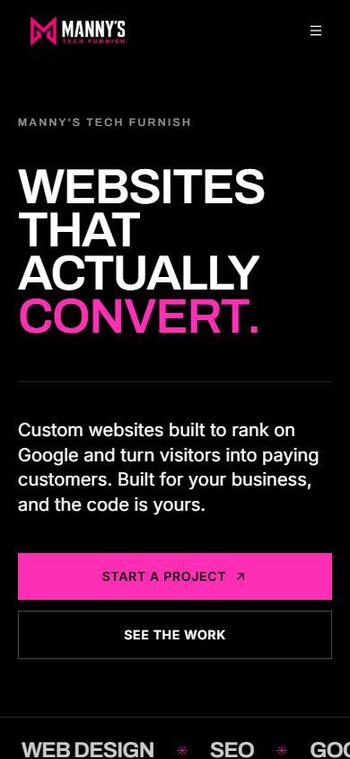
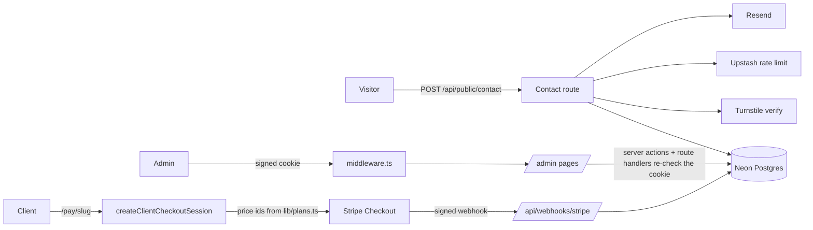

# Manny's Tech Furnish

The production site and back office for my web development studio: **[mannystechfurnish.com](https://mannystechfurnish.com)**.

It does three jobs. It markets the studio, it captures leads through a bot-protected contact form, and it gets clients paid up through per-client Stripe checkout links that I create from a private admin dashboard.


<p align="center"></p>

[](https://github.com/spoutyfc/mannystechfurnish/actions/workflows/ci.yml)

## Stack

| Layer | Choice |
|---|---|
| Framework | Next.js 16 (App Router, server actions, route handlers), React 19, TypeScript |
| Data | Neon Postgres with Drizzle ORM (`lib/db/schema.ts`) |
| Auth | HMAC-signed admin session cookie (`lib/admin-auth.ts`) and bcrypt password hashes |
| Payments | Stripe Checkout Sessions for client invoices, and Stripe Payment Links for the public pricing table |
| Email | Resend, with escaped HTML templates (`lib/email.ts`) |
| Abuse controls | Cloudflare Turnstile, Upstash Redis sliding-window rate limits, and a honeypot field |
| UI | Tailwind CSS v4, Framer Motion, GSAP, Lenis |
| Quality | Vitest, ESLint 9 (next/core-web-vitals and typescript), `tsc --noEmit`, and GitHub Actions on Ubuntu |
| Runtime | Vercel in production. A multi-stage Docker image (Next standalone output, non-root) is also included |

## What it does

**Public site**
- Marketing pages under `app/(site)/` for one offer, the AEC Digital Growth Partner ($1,000/month), aimed at Bay Area engineering and construction firms: `/`, `/engineering-construction`, `/work`, `/growth-partner`, `/process`, `/about`, `/privacy`, `/accessibility`. Shared copy and case-study facts live in `lib/site-content.ts`.
- `/contact` is a fit-call request form. The server validates the input (including firm, discipline and website), checks Turnstile (required in any production build) and the rate limit, stores it in Postgres and emails both me and the sender.
- `/pay/[slug]` is a personal invoice page for one client. The price always comes from the plan stored on the server.
- `/demo/booking` is the old booking add-on demo, kept for existing links and excluded from search.

Research, the capacity model, prospect lists and outreach drafts for the repositioning are in `research/`; QA evidence is in `QA-REPORT.md` and `docs/evidence/`.

**Admin** (`/admin`, gated in middleware and on every handler)
- An inbox of contact submissions, where each one can be marked new, read or resolved, or deleted.
- A composer that sends branded emails to a client through Resend.
- `/admin/clients` lets me create a client on a plan, copy their pay link, mark a payment and see totals collected.
- Password change, which re-verifies the current password.

## Architecture



### Payment flow

1. In the admin dashboard I create a client and pick a plan (`option1` or `option2`). The server then generates an unguessable slug.
2. The client opens `/pay/<slug>`. That page reads only the public fields it needs: name, company, plan and whether it is paid.
3. **Pay** calls a server action. The action validates the slug, refuses if the invoice is already paid, and builds the Stripe line items from stored price ids with `lib/checkout.ts`. The browser never sends an amount.
4. Stripe calls `/api/webhooks/stripe`. The route verifies the signature, then applies the event through `lib/payment-status.ts`. A paid client is never downgraded by a late "expired" or "failed" event, and only the session currently on record can mark a client failed. If the database write fails, the route returns 500 so that Stripe retries.

### Data model (main tables)

| Table | Purpose |
|---|---|
| `clients` | Invoice recipients: slug, contact details, plan, payment status, Stripe customer, session and subscription ids |
| `contact_inquiries` | Contact form submissions with a status of `new`, `read` or `resolved` |
| `admin_users` | Admin email and bcrypt hash. It is managed with raw parameterized SQL and is not in the Drizzle schema |
| `user`, `session`, `account`, `verification` | Better Auth tables. Public inquiries are attached to a fixed system user |

## Security notes

- **Server-side validation.** Every public input and every admin mutation is parsed with zod (`lib/validation.ts`) before any database, Stripe or email call.
- **Admin sessions.** The cookie holds `email.expiry.HMAC-SHA256` and is verified in constant time with Web Crypto, which works in both Edge middleware and Node. It is `httpOnly` and `secure`, and `SameSite=Lax` in production. If no secret is configured, verification throws instead of letting the request through.
- **Defense in depth.** Middleware guards `/admin/*`, and each admin route handler and server action checks the session again on its own.
- **Bootstrap endpoint.** `/api/admin-setup` returns 404 unless `ADMIN_SETUP_SECRET` is set. It compares the secret in constant time and requires a password of at least 12 characters.
- **Login hardening.** Admin login is rate-limited per IP, and bcrypt runs even for unknown emails so response timing does not reveal which accounts exist.
- **Queries.** All SQL goes through Drizzle or tagged `sql` templates, which are parameterized.
- **Email.** Every value from the user is HTML-escaped before it goes into a template.

## Local setup

Requirements: Node 20.9 or newer, pnpm 10 (`corepack enable`), and a Postgres database such as Neon.

```bash
corepack enable
pnpm install
cp .env.example .env.local   # fill in values; names are documented in the file
pnpm dev                     # http://localhost:3000
```

The site runs without Turnstile and Upstash configured, because those checks are skipped when their keys are absent. Stripe, Resend and the database are only needed for the flows that use them.

To create the first admin, set `ADMIN_SETUP_SECRET` and send a POST to `/api/admin-setup` with the `x-setup-secret` header and an `{ "email", "password" }` body. Unset the secret afterwards.

## Checks

```bash
pnpm typecheck   # tsc --noEmit
pnpm lint        # eslint .
pnpm test        # vitest run
pnpm build       # next build (standalone output)
```

The tests (`lib/__tests__`, `app/__tests__`) cover:
- validation boundaries
- checkout pricing, including rejection of unknown plans
- webhook status transitions and retry behaviour
- forgery, expiry and missing-secret cases for the admin token
- unauthenticated calls to every admin route and server action

CI (`.github/workflows/ci.yml`) runs all four checks on `ubuntu-latest`. It then builds the Docker image and smoke-tests the container's `/api/health` endpoint.

## Docker

```bash
docker build -t mannystechfurnish .
docker run --env-file .env -p 3000:3000 mannystechfurnish
```

The build has three stages: `deps`, then `build`, then a slim runtime. The runtime stage runs as the unprivileged `node` user and has a `HEALTHCHECK` against `/api/health`. Secrets are injected at runtime, and only `NEXT_PUBLIC_*` values are build arguments.

## Project layout

```
app/                 routes, server actions (app/actions), API route handlers (app/api)
components/site/     marketing page sections and motion primitives
components/admin/    admin dashboard widgets
lib/                 db, auth, Stripe, email, validation, pricing and status logic
scripts/             one-off Stripe Payment Link setup
docs/screenshots/    images used in this README
```

## Author

Built and maintained by Mansoor Arif ([@spoutyfc](https://github.com/spoutyfc)).
